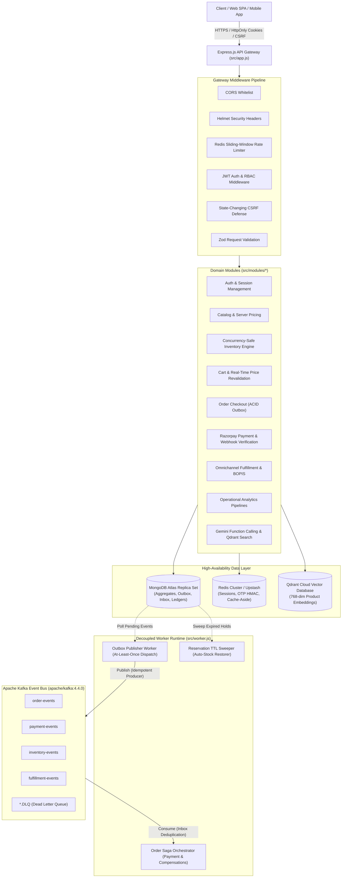
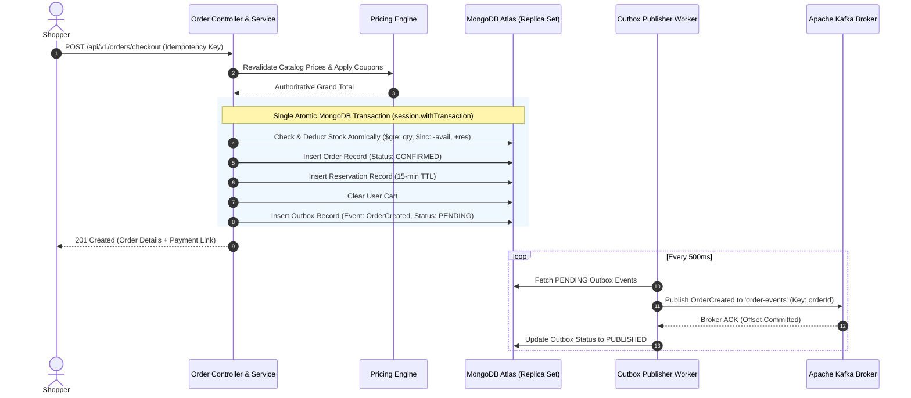
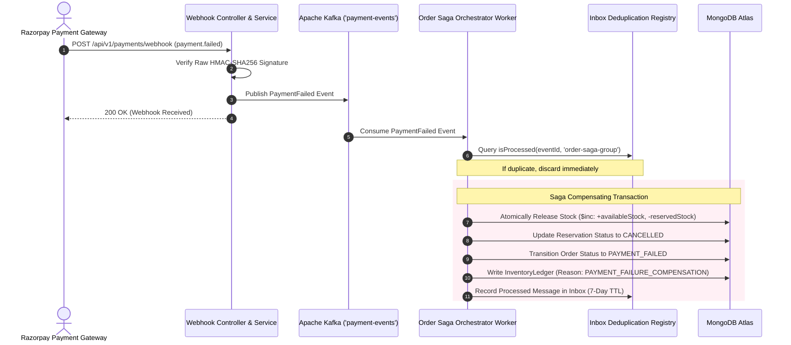

# OmniRetail — Intelligent Omnichannel Commerce & Inventory Management System


-brightgreen)

> **OmniRetail** is an enterprise-grade, Walmart-inspired omnichannel retail backend platform designed to demonstrate advanced backend architecture, distributed systems patterns, high-concurrency race condition prevention, multi-store geospatial routing, transactional outbox event streaming with Apache Kafka, memory-hard Argon2id authentication, and Generative AI shopping operations with native function calling.

---

## Table of Contents
1. [System Architecture](#system-architecture)
   - [Component Topology](#component-topology)
   - [Atomic Checkout & Transactional Outbox Flow](#atomic-checkout--transactional-outbox-flow)
   - [Distributed Order Saga Compensation Flow](#distributed-order-saga-compensation-flow)
2. [Core Engineering Solutions](#core-engineering-solutions)
   - [1. Concurrency Control & Atomic Stock Allocation](#1-concurrency-control--atomic-stock-allocation)
   - [2. Dual-Write Prevention via Transactional Outbox](#2-dual-write-prevention-via-transactional-outbox)
   - [3. Idempotent Message Consumers with Inbox Deduplication](#3-idempotent-message-consumers-with-inbox-deduplication)
   - [4. Distributed Order Saga Orchestrator](#4-distributed-order-saga-orchestrator)
   - [5. Omnichannel Proximity Fulfillment & BOPIS](#5-omnichannel-proximity-fulfillment--bopis)
   - [6. Real-Time Analytics Aggregation Pipelines](#6-real-time-analytics-aggregation-pipelines)
   - [7. Generative AI Shopping Assistant & Qdrant RAG](#7-generative-ai-shopping-assistant--qdrant-rag)
   - [8. Memory-Hard Auth & Token Family Rotation (RFC 6819)](#8-memory-hard-auth--token-family-rotation-rfc-6819)
3. [Strict Clean Code & Architectural Invariants](#strict-clean-code--architectural-invariants)
4. [Project Directory Layout](#project-directory-layout)
5. [Local Setup & Step-by-Step Run Guide](#local-setup--step-by-step-run-guide)
6. [Complete REST API Catalog](#complete-rest-api-catalog)
7. [Staff & Senior Engineer Interview Deep-Dive Q&A](#staff--senior-engineer-interview-deep-dive-qa)

---

## System Architecture

OmniRetail is architected as a **Modular Monolith** with decoupled asynchronous worker runtimes (`src/server.js` for synchronous HTTP API traffic and `src/worker.js` for Kafka event consumers, outbox publishers, and reservation sweepers).

### Component Topology



---

### Atomic Checkout & Transactional Outbox Flow



---

### Distributed Order Saga Compensation Flow



---

## Core Engineering Solutions

### 1. Concurrency Control & Atomic Stock Allocation
- **The Problem:** In high-volume flash sales, hundreds of requests attempt to buy the last inventory unit in the exact same millisecond. Traditional `SELECT -> check stock -> UPDATE` suffers from race conditions where multiple requests read positive stock and drive inventory negative (overselling).
- **The Architecture:** Zero application locks, zero distributed locks. We leverage **Atomic Conditional Expressions** at the MongoDB document level:
  ```javascript
  const inventory = await Inventory.findOneAndUpdate(
    {
      productId,
      locationId,
      availableStock: { $gte: quantity } // Atomic filter invariant
    },
    {
      $inc: {
        availableStock: -quantity,
        reservedStock: +quantity
      }
    },
    { new: true, session }
  );
  ```
  If available stock is less than `quantity`, the filter fails, 0 documents are modified, and `null` is returned atomically. Tested under 10 parallel racing threads with exactly 1 winner and 0 overselling.

### 2. Dual-Write Prevention via Transactional Outbox
- **The Problem:** Writing to a database and publishing to Kafka in an HTTP handler is inherently prone to partial failure. If the database commit succeeds but Kafka fails (network timeout), events are lost forever. If Kafka succeeds but the database rolls back, downstream systems process phantom events.
- **The Architecture:** In a single MongoDB replica-set transaction (`session.withTransaction`), we insert the domain entities (`Order`, `Reservation`) and write an `Outbox` document. The asynchronous `outbox.worker.js` polls pending outbox records, publishes to Kafka with retry backoff, and marks records `PUBLISHED` upon broker ACK.

### 3. Idempotent Message Consumers with Inbox Deduplication
- **The Problem:** Distributed messaging brokers guarantee **At-Least-Once Delivery**. Network partitions, consumer group rebalances, or producer retries inevitably produce duplicate messages.
- **The Architecture:** Every message carries a unique, deterministic `eventId`. Before executing business logic, consumers query the `inbox` collection indexed on `{ messageId: 1, consumerGroup: 1 }`. If a message was already processed, it is safely skipped. Upon execution, the message is registered in the Inbox with a 7-day TTL index.

### 4. Distributed Order Saga Orchestrator
- **The Problem:** 2-Phase Commit (2PC) blocks all database participants, creating severe latency bottlenecks and single points of failure across payment gateways.
- **The Architecture:** An orchestrated saga (`src/modules/sagas/orderSaga.orchestrator.js`):
  - **Happy Path:** `PaymentCaptured` -> Transitions order to `ALLOCATED` -> triggers fulfillment.
  - **Compensating Path:** `PaymentFailed` -> Automatically restores available inventory, zeroes reserved stock, cancels reservation holds, updates order to `PAYMENT_FAILED`, and records an audit ledger entry.

### 5. Omnichannel Proximity Fulfillment & BOPIS
- **The Problem:** Blindly routing all orders to a central warehouse causes slow shipping times and high freight costs.
- **The Architecture:** Geospatial routing using MongoDB `2dsphere` indexes:
  - Calculates distance to the customer using `$near` spherical math.
  - Evaluates nearby physical Stores (`SHIP_FROM_STORE` within 30km) with available shelf stock.
  - Automatically falls back to regional Warehouses (`REGIONAL_WAREHOUSE`) or Central Distribution Centers (`DISTRIBUTION_CENTER`).
  - **BOPIS Engine:** Verifies instant in-store Click & Collect eligibility and locks shelf inventory for customer pickup.
  - **Inter-Store Transfers:** Lifecycle (`REQUESTED` -> `IN_TRANSIT` -> `RECEIVED`) with atomic origin debit and destination credit.

### 6. Real-Time Analytics Aggregation Pipelines
- **The Problem:** Loading thousands of orders into Node.js memory to compute GMV or channel revenue crashes the event loop.
- **The Architecture:** Native C++ MongoDB aggregation pipelines:
  - Store-level GMV, total order count, and Average Order Value (AOV) via `$group` and `$round`.
  - Network-wide inventory health: identifies out-of-stock SKUs and low-stock alerts.
  - Channel revenue split: aggregates BOPIS vs Home Delivery sales in sub-100ms.

### 7. Generative AI Shopping Assistant & Qdrant RAG
- **The Problem:** Traditional search fails on conversational queries, while LLM chatbots hallucinate prices and fake order statuses.
- **The Architecture:**
  - **Qdrant Vector Database:** 768-dimensional product embeddings stored in Qdrant Cloud for semantic search.
  - **Gemini Native Function Calling:** Autonomous retail tools (`check_product_stock`, `find_nearest_store`, `track_order`). Gemini queries the actual live backend database before answering the customer, guaranteeing zero hallucinated inventory.

### 8. Memory-Hard Auth & Token Family Rotation (RFC 6819)
- **The Architecture:**
  - **Argon2id:** Password hashing with $64\text{ MB}$ memory cost, 3 iterations, and 4 threads, neutralizing GPU/ASIC brute-force clusters.
  - **Dual-Token System:** 15-minute JWT Access Token + 7-day Opaque Refresh Token stored in `HttpOnly`, `Secure`, `SameSite=Lax` cookies.
  - **Token Family Reuse Detection:** If an already-rotated refresh token is replayed (indicating token theft), the system flags the intrusion and immediately revokes all active sessions across all devices for that user.
  - **Redis Keyed HMAC OTP:** 6-digit codes hashed with HMAC-SHA256, 5-minute TTL, 60-second resend cooldown, and strict 5-attempt brute-force lockouts.

---

## Strict Clean Code & Architectural Invariants

| Invariant | Standard Applied | Enforcement Mechanism |
| :--- | :--- | :--- |
| **Function Length** | Strictly $\le 40$ physical lines (targeting 10–25 lines) | Automated static script check across all `src/` modules. |
| **Separation of Concerns** | Controllers format HTTP only; Services hold business rules; Repositories execute database queries | Zero Mongoose queries inside controllers; Zod validation in middleware. |
| **Unified API Response** | `sendSuccess(res, msg, data, code, meta)` / `sendCreated(res, msg, data)` | Normalized `{ success, message, data, meta }` JSON envelope. |
| **Zero Overselling** | Conditional `$inc` with `$gte` filter invariants | Multi-threaded concurrency test suite (`inventory.test.js`). |
| **Dual-Write Immunity** | Transactional Outbox Pattern | MongoDB `session.withTransaction` wrapping entities + outbox. |
| **Idempotent Consumers** | Inbox Deduplication Pattern | Unique compound index `{ messageId: 1, consumerGroup: 1 }`. |

---

## Project Directory Layout

```
omni-retail-backend/
├── .env.example                               # Environment template with full documentation
├── docker-compose.yml                         # Local Docker infrastructure (Kafka, Redis)
├── package.json                               # Dependencies, engines, and test scripts
├── README.md                                  # Production architecture & interview guide
├── docs/
│   ├── architecture.md                        # High-level architecture documentation
│   └── interview-explanations.md              # 16 in-depth Staff/SDE engineering design decisions
├── src/
│   ├── app.js                                 # Express application configuration & middleware
│   ├── server.js                              # HTTP API Gateway entry point (Port 5000)
│   ├── worker.js                              # Background worker runtime (Outbox, Sweeper, Saga)
│   ├── config/                                # Strongly typed Zod environment & client configs
│   │   ├── env.config.js
│   │   ├── database.config.js
│   │   ├── redis.config.js
│   │   ├── kafka.config.js
│   │   ├── razorpay.config.js
│   │   ├── gemini.config.js
│   │   └── qdrant.config.js
│   ├── database/
│   │   ├── connection.js                      # MongoDB Atlas connection manager & replica set verification
│   │   └── seed.js                            # Enterprise retail synthetic database seeder
│   ├── infrastructure/
│   │   ├── redis/redis.client.js              # Redis connection manager with auto-reconnect
│   │   ├── kafka/                             # KafkaJS client, producer, consumer, admin, topics
│   │   │   ├── kafka.client.js
│   │   │   ├── producer.js
│   │   │   ├── consumer.js
│   │   │   ├── admin.js
│   │   │   ├── topics.js
│   │   │   ├── eventEnvelope.js
│   │   │   └── dlq.service.js
│   │   ├── razorpay/razorpay.client.js        # Razorpay SDK initialization
│   │   ├── email/mailer.js                    # Nodemailer transporter & email templates
│   │   └── shutdown.js                        # POSIX SIGINT/SIGTERM graceful shutdown orchestrator
│   ├── common/
│   │   ├── constants/                         # Roles (ADMIN, STORE_MANAGER, CUSTOMER), order statuses
│   │   ├── errors/AppError.js                 # Centralized AppError with errorCodes enum
│   │   ├── middleware/                        # Auth, RBAC, CSRF, rate limiter, request logger, error handler
│   │   └── utils/                             # Crypto utils, JWT utils, logger, responseHandler
│   ├── workers/
│   │   ├── outbox.worker.js                   # Transactional outbox publisher
│   │   └── reservation.worker.js              # 15-minute stock hold expiration sweeper
│   └── modules/
│       ├── auth/                              # Authentication, Argon2id, Session rotation, OTP
│       ├── users/                             # User profiles & RBAC management
│       ├── categories/                        # Hierarchical category tree
│       ├── catalog/                           # Product catalog, SKU uniqueness, Cloudinary uploads
│       ├── pricing/                           # Authoritative server-side pricing & coupon engine
│       ├── locations/                         # Stores & Warehouses with GeoJSON 2dsphere indexing
│       ├── inventory/                         # Concurrency-safe inventory & append-only ledger
│       ├── cart/                              # Persistent cart with real-time price & stock revalidation
│       ├── orders/                            # Order checkout with Transactional Outbox
│       ├── payments/                          # Razorpay order generation & raw webhook signature verification
│       ├── sagas/                             # Order Saga Orchestrator (PaymentCaptured & Compensations)
│       ├── fulfillment/                       # Proximity routing (Ship-from-store vs Warehouse) & BOPIS
│       ├── transfers/                         # Inter-store stock transfer lifecycle
│       ├── analytics/                         # Native MongoDB aggregation analytics pipelines
│       └── ai/                                # Gemini Function Calling & Qdrant semantic search
└── tests/
    ├── unit/                                  # 10 Unit test suites (AppError, JWT, Crypto, Pricing, etc.)
    ├── integration/                           # 10 Integration test suites (Auth, Catalog, Orders, Saga, etc.)
    └── concurrency/                           # High-concurrency race condition test suite
```

---

## Local Setup & Step-by-Step Run Guide

### 1. Prerequisites
- **Node.js**: `v20.0.0+` (tested and verified on `v22.13.1`)
- **Docker & Docker Compose**: (for local Kafka broker)
- **MongoDB Atlas**: Replica Set cluster (required for multi-document transactions)
- **Redis**: Upstash TLS instance or local Redis

### 2. Kafka Local Setup (Docker)
Start Apache Kafka locally using Docker:
```bash
docker run -d --name kafka -p 9092:9092 apache/kafka:4.4.0
```
Verify the container is healthy:
```bash
docker ps --filter "name=kafka"
```

### 3. Environment Configuration
Copy `.env.example` to `.env` and fill in your connection strings:
```bash
cp .env.example .env
```
Ensure `KAFKA_BROKERS=localhost:9092` is set in `.env`.

### 4. Install Dependencies
```bash
npm install
```

### 5. Seed Database
Seed the database with test users, stores, regional warehouses, catalog products, multi-location inventory, and coupons:
```bash
npm run seed
```

### 6. Run Automated Test Suites
Run all 21 test suites (80 tests) sequentially with zero race conditions:
```bash
npm test
```
*Expected output: `tests 80, suites 21, pass 80, fail 0 (100% passing)`.*

### 7. Start API Gateway Server
```bash
npm run dev
```
Server boots on `http://localhost:5000` with CORS, Helmet, and structured Pino logging.

### 8. Start Background Worker Runtime
In a separate terminal, launch the decoupled worker process:
```bash
npm run worker
```
Starts the Outbox Publisher Worker, Reservation Sweeper Worker, and Kafka Order Saga Orchestrator.

---

## Complete REST API Catalog

All endpoints return a standardized JSON response:
```json
{
  "success": true,
  "message": "Operation description",
  "data": { ... },
  "meta": { "timestamp": "2026-11-05T12:00:00.000Z" }
}
```

### 1. Authentication & Users (`/api/v1/auth`, `/api/v1/users`)
| Method | Endpoint | Auth / Role | Description |
| :--- | :--- | :--- | :--- |
| `POST` | `/api/v1/auth/register` | Public | Register customer; dispatches 6-digit email OTP. |
| `POST` | `/api/v1/auth/verify-otp` | Public | Verify OTP via Redis HMAC; activates account. |
| `POST` | `/api/v1/auth/login` | Public | Authenticate with Argon2id; issues HttpOnly cookies. |
| `POST` | `/api/v1/auth/refresh` | Cookie (`refreshToken`) | Rotates refresh token; triggers token family theft detection. |
| `POST` | `/api/v1/auth/logout` | Authenticated | Revokes active session and clears cookies. |
| `GET` | `/api/v1/users/me` | Authenticated | Fetch authenticated user profile. |

### 2. Catalog & Pricing (`/api/v1/categories`, `/api/v1/products`, `/api/v1/pricing`)
| Method | Endpoint | Auth / Role | Description |
| :--- | :--- | :--- | :--- |
| `GET` | `/api/v1/categories` | Public | Fetch category hierarchy tree. |
| `POST` | `/api/v1/categories` | `ADMIN` | Create hierarchical product category. |
| `GET` | `/api/v1/products` | Public | Paginated product search with text matching. |
| `GET` | `/api/v1/products/:id` | Public | Fetch product details (Redis cache-aside). |
| `POST` | `/api/v1/products` | `ADMIN` | Create product (invalidates cache). |
| `POST` | `/api/v1/pricing/calculate` | Public | Authoritative server-side pricing & coupon calculation. |

### 3. Inventory & Locations (`/api/v1/locations`, `/api/v1/inventory`)
| Method | Endpoint | Auth / Role | Description |
| :--- | :--- | :--- | :--- |
| `GET` | `/api/v1/locations` | Public | List fulfillment locations with GeoJSON coordinates. |
| `POST` | `/api/v1/locations` | `ADMIN` | Create Store or Regional Warehouse location. |
| `GET` | `/api/v1/inventory/product/:id` | Public | Get multi-location inventory balances. |
| `POST` | `/api/v1/inventory/adjust` | `STORE_MANAGER`, `ADMIN` | Adjust physical stock with audit ledger write. |

### 4. Cart & Orders (`/api/v1/cart`, `/api/v1/orders`)
| Method | Endpoint | Auth / Role | Description |
| :--- | :--- | :--- | :--- |
| `GET` | `/api/v1/cart` | Authenticated | Fetch cart with real-time price & stock revalidation. |
| `POST` | `/api/v1/cart/items` | Authenticated | Add/update item quantity in cart. |
| `POST` | `/api/v1/orders/checkout` | Authenticated | Atomic checkout (writes Order, Reservation, Outbox). |
| `GET` | `/api/v1/orders/:orderId` | Authenticated (Owner) | Fetch order status and line items. |
| `POST` | `/api/v1/orders/:orderId/cancel`| Authenticated (Owner) | Cancel order and release reserved stock. |

### 5. Payments & Webhooks (`/api/v1/payments`)
| Method | Endpoint | Auth / Role | Description |
| :--- | :--- | :--- | :--- |
| `POST` | `/api/v1/payments/create-order` | Authenticated | Create Razorpay payment gateway order (in paise). |
| `POST` | `/api/v1/payments/verify` | Authenticated | Verify payment HMAC-SHA256 signature. |
| `POST` | `/api/v1/payments/webhook` | Gateway Signature | Process raw body webhook (`payment.captured`, `payment.failed`). |

### 6. Omnichannel Fulfillment & Transfers (`/api/v1/fulfillment`, `/api/v1/transfers`)
| Method | Endpoint | Auth / Role | Description |
| :--- | :--- | :--- | :--- |
| `POST` | `/api/v1/fulfillment/source` | Public | Geospatial proximity routing (`SHIP_FROM_STORE` vs `REGIONAL_WAREHOUSE`). |
| `POST` | `/api/v1/fulfillment/stores/:id/bopis-check`| Public | Check instant Buy Online, Pick Up in Store eligibility. |
| `POST` | `/api/v1/transfers/request` | `STORE_MANAGER`, `ADMIN` | Request inter-store stock transfer (places origin stock on hold). |
| `POST` | `/api/v1/transfers/:id/dispatch`| `STORE_MANAGER`, `ADMIN` | Dispatch transfer (`IN_TRANSIT`). |
| `POST` | `/api/v1/transfers/:id/receive` | `STORE_MANAGER`, `ADMIN` | Receive transfer (credits destination shelf stock). |

### 7. Operational Analytics (`/api/v1/analytics`)
| Method | Endpoint | Auth / Role | Description |
| :--- | :--- | :--- | :--- |
| `GET` | `/api/v1/analytics/stores/sales` | `ADMIN` | Aggregates Store GMV, total orders, and AOV. |
| `GET` | `/api/v1/analytics/inventory/health`| `ADMIN` | Network-wide stock health, stockouts, and low-stock alerts. |
| `GET` | `/api/v1/analytics/channels/split` | `ADMIN` | Revenue breakdown across BOPIS vs Delivery channels. |

### 8. Generative AI Shopping Assistant (`/api/v1/ai`)
| Method | Endpoint | Auth / Role | Description |
| :--- | :--- | :--- | :--- |
| `POST` | `/api/v1/ai/chat` | Public | Gemini shopping assistant with native Function Calling. |
| `GET` | `/api/v1/ai/search` | Public | Semantic vector search via Qdrant Cloud. |

### 9. System Probes (`/api/v1/health`, `/ready`, `/live`)
| Method | Endpoint | Description |
| :--- | :--- | :--- |
| `GET` | `/api/v1/health` | Comprehensive health check (MongoDB Atlas, Redis, Kafka). |
| `GET` | `/api/v1/health/live` | Kubernetes Liveness probe (process responsiveness). |
| `GET` | `/api/v1/health/ready` | Kubernetes Readiness probe (database connection status). |

---

## Staff & Senior Engineer Interview Deep-Dive Q&A

### Q1: How do you prevent inventory overselling during high-concurrency flash sales?
> **Answer:** Rather than using pessimistic locking (`SELECT ... FOR UPDATE`), which creates catastrophic row-lock contention and deadlocks, or naive read-then-write application logic, we enforce atomic conditional updates directly in the MongoDB storage engine:
> ```javascript
> Inventory.findOneAndUpdate(
>   { productId, locationId, availableStock: { $gte: quantity } },
>   { $inc: { availableStock: -quantity, reservedStock: +quantity } }
> );
> ```
> The condition `{ availableStock: { $gte: quantity } }` acts as an atomic lock-free barrier. If available inventory is insufficient, the document is untouched and `null` is returned atomically. This guarantees mathematical zero overselling under arbitrary concurrency without cross-request lock serialization.

### Q2: What is the Dual-Write Problem and how does the Transactional Outbox pattern solve it?
> **Answer:** In distributed systems, updating a database and publishing an event to a message broker (Kafka) in the same handler creates the Dual-Write Problem: one can succeed while the other fails. Distributed 2-Phase Commit (2PC) between MongoDB and Kafka is impractical due to high latency and failure cascades.
> 
> We solve this by persisting both the domain entities (`Order`, `Reservation`) and an `Outbox` event record within a single ACID transaction (`session.withTransaction`). Since both writes occur in the same database transaction, either both succeed or neither does. A decoupled background Outbox Publisher Worker polls `PENDING` events, delivers them to Kafka with retry backoffs, and marks them `PUBLISHED` upon broker ACK.

### Q3: Since Kafka guarantees At-Least-Once Delivery, how do you prevent duplicate message processing?
> **Answer:** We implement the **Inbox Deduplication Pattern**. Every published event includes a deterministic `eventId` in its standard envelope. Before executing any business action, consumers query an `inbox` collection with a unique compound index on `{ messageId: 1, consumerGroup: 1 }`. If the event was already handled, it is immediately discarded. After business logic completes, an inbox record is created with a 7-day TTL index, ensuring complete idempotency across consumer crashes or rebalances.

### Q4: How does your system handle compensation when a payment fails in an asynchronous saga?
> **Answer:** We employ an **Orchestrated Saga Pattern**. When Razorpay sends a `payment.failed` webhook, the gateway service publishes a `PaymentFailed` event to Kafka. The `OrderSagaOrchestrator` consumes the event, verifies inbox deduplication, and initiates compensating transactions:
> 1. Atomically increments `availableStock` and decrements `reservedStock`.
> 2. Sets the reservation status to `CANCELLED`.
> 3. Transitions the order status to `PAYMENT_FAILED`.
> 4. Writes an `InventoryLedger` entry recording the compensation reason.
> This ensures reserved stock is automatically returned to the shelf without manual intervention or permanent inventory leakage.

### Q5: How do you protect authentication tokens from theft and replay attacks?
> **Answer:** We implement a **Hybrid Dual-Token Architecture with Token Family Rotation (RFC 6819)**:
> - Access tokens are short-lived JWTs ($15\text{ minutes}$), eliminating database lookups on high-throughput requests.
> - Refresh tokens are long-lived opaque random tokens ($7\text{ days}$) stored as SHA-256 hashes in MongoDB.
> - Both tokens are stored strictly in `HttpOnly`, `Secure`, `SameSite=Lax` cookies, completely shielding them from JavaScript exfiltration via Cross-Site Scripting (XSS).
> - **Reuse Detection:** When a refresh token is rotated, the previous token hash is archived. If an incoming request presents an archived token, it indicates token replay (theft). The system immediately revokes the entire user session family across all devices, locking out the intruder.

### Q6: Why Argon2id over Bcrypt for password security?
> **Answer:** Bcrypt is CPU-bound with negligible memory consumption ($4\text{ KB}$), allowing threat actors to execute billions of candidate guesses per second using massively parallel GPU and ASIC clusters. Argon2id (winner of the Password Hashing Competition) is memory-hard. Configured with $64\text{ MB}$ of memory cost, 3 iterations, and 4 threads, parallelizing attacks on hardware accelerators becomes economically infeasible due to physical memory bandwidth saturation.

### Q7: How does proximity routing determine between Ship-from-Store vs Regional Warehouse?
> **Answer:** Using MongoDB GeoJSON `2dsphere` indexes, the fulfillment engine evaluates stores sorted by spherical distance from customer coordinates (`$near`). If a physical retail store within a 30km radius has all line items available on shelf stock, the order is routed as `SHIP_FROM_STORE` to minimize courier cost and enable same-day delivery. If no local store has complete stock, the order falls back to the nearest `REGIONAL_WAREHOUSE` or Central Distribution Center.

### Q8: How do you verify Razorpay webhooks without signature mismatch bugs?
> **Answer:** Webhook HMAC-SHA256 signatures must be computed over the raw, untouched byte stream sent by the payment provider. Re-serializing parsed JSON (`JSON.stringify(req.body)`) alters key ordering, spacing, and Unicode escapes, corrupting signature verification. We configure `express.json()` with a `verify` hook that preserves the untouched raw buffer on `req.rawBody` prior to parsing:
> ```javascript
> express.json({ verify: (req, _res, buf) => { req.rawBody = buf; } });
> ```
> Signatures are then verified against `req.rawBody` using `crypto.timingSafeEqual` to eliminate timing attacks.

### Q9: How do you prevent Generative AI chatbots from hallucinating retail stock and pricing?
> **Answer:** We use **Gemini Native Function Calling** coupled with **Qdrant Vector RAG**. The LLM is strictly prohibited from guessing inventory counts or order statuses. When a customer asks "Is the Sony XM5 in stock at Dallas North?", Gemini autonomously selects and calls the `check_product_stock` tool. The backend executes the live database query and returns the verified JSON payload to Gemini. Gemini synthesizes the natural language response grounded exclusively in verified database truth.

### Q10: Why choose a Modular Monolith with Decoupled Workers over 10 independent microservices?
> **Answer:** Premature microservices introduce distributed 2PC challenges, high p99 network latency, IPC serialization overhead, and deployment complexity before domain models stabilize. OmniRetail uses a **Modular Monolith**: strict directory encapsulation (`src/modules/*`) where modules only interact via published service interfaces, coupled with separate runtime entrypoints (`server.js` for HTTP traffic and `worker.js` for Kafka/background jobs). This provides the operational simplicity of a single deployable unit while allowing clean extraction into microservices if organizational boundaries require it.

---

## License
MIT License. Developed for Staff & Senior Backend Software Engineering demonstration.
